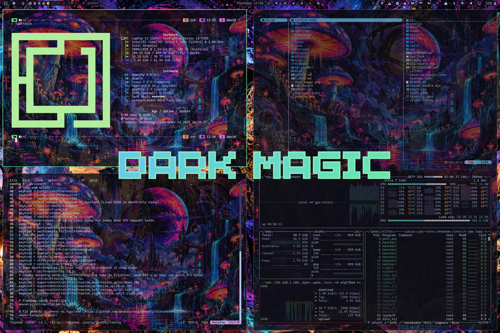
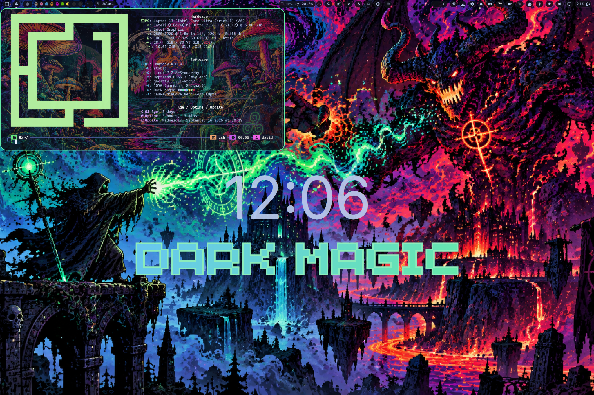

# Dark Magic Theme

A dark Omarchy theme with mint accent (#66eeaa) and blue secondary (#6bc7f5).

## Preview




## Installation

### Omarchy Theme

Install directly from this repo:

```bash
omarchy theme install https://github.com/davidsmorais/omarchy-dark-magic-theme
```

Or use the Omarchy menu: `Super + Space` → `Install > Style > Theme`, then paste the repo URL.

Once installed, activate it with:

```bash
omarchy theme set "Dark Magic"
```

## What's Included

- `colors.toml` - Full 16-color palette with mint accent (#66eeaa) and blue secondary (#6bc7f5)
- `btop.theme` - btop++ system monitor theme
- `cava_theme` - Cava audio visualizer gradient theme
- `chromium.theme` - Chromium browser theme colors
- `gtk.css`, `gtk-3.0/`, `gtk-4.0/` - GTK 3 and GTK 4 / Libadwaita styling
- `hyprland.conf` - Window manager config with mint accent borders and smooth animations
- `hyprland-preview-share-picker.css` - Screen share picker styling
- `hyprlock.conf` - Hyprlock lockscreen theme
- `icons.theme` - Icon theme configuration
- `mako.ini` - Mako notification daemon styling with Wi-Fi & update actions
- `obsidian.css` - Obsidian markdown editor theme
- `qt6ct.conf` - Qt6 configuration tool color scheme
- `steam.css` - Adwaita-for-Steam theme
- `superfile.toml` - Superfile terminal file manager theme
- `swayosd.css` - SwayOSD on-screen display theme
- `system24.css` & `vencord.theme.css` - Discord / Vencord / Vesktop system24 styling
- `walker.css` - Walker application launcher theme
- `waybar.css` - Waybar status bar palette styling
- `zed.json` & `zed/themes/` - Zed editor theme configuration
- `zen.css` - Zen Browser color styling
- `backgrounds/` - Theme backgrounds including signature `dark-magic.webp`
- `terminal-backgrounds/` - 5 high-res shroom wallpapers

## Credits

Created by David Morais (davidsmorais)

